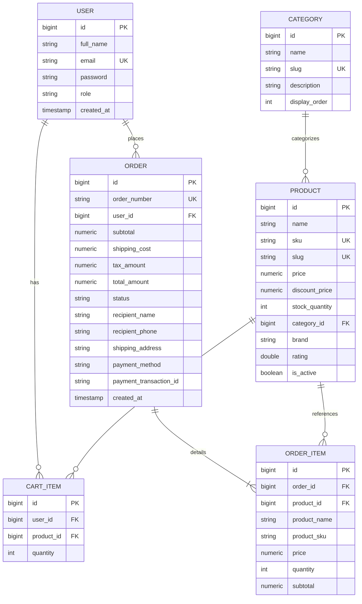

# ShopNova Commerce Platform: System Architecture & Specifications
**Academic Deliverable S1 | Final Year B.Tech Project**
**Author:** Ayush S. Mule (Team Lead & System Architect)

---

## 1. Project Charter & Scope

### Executive Summary
ShopNova is a responsive, reliable full-stack e-commerce web platform engineered for modern web shopping inspired by Amazon and Flipkart. Built with a Spring Boot 3 modular monolith and React 18 SPA, the architecture prioritizes rapid startup, transactional safety, clean domain segregation, and zero-complexity local execution.

### Key Objectives
1. **Customer Discovery**: Sub-second full-text catalog search, multi-category taxonomy, and high-resolution product showcases.
2. **Transactional Integrity**: Concurrency-safe atomic inventory deductions (`UPDATE ... WHERE stock >= quantity`) preventing overselling.
3. **Stateless Authentication**: JJWT (v0.12.6) Bearer tokens with BCrypt password hashing and role-based access control (`ROLE_CUSTOMER`, `ROLE_ADMIN`).
4. **Operations Console**: Comprehensive administrative console for KPI tracking, inventory replenishment, and order state transitions.

---

## 2. Component Architecture Diagram

```
+-----------------------------------------------------------------------------------+
|                           REACT 18 + VITE FRONTEND (:5173)                        |
|                                                                                   |
|  [Customer Flow: Catalog -> Detail Modal -> Persistent Cart -> Mock Checkout]    |
|  [Admin Flow: KPI Dashboard -> Inventory Management -> Order Fulfillment]         |
+-----------------------------------------+-----------------------------------------+
                                          | HTTP REST (JSON / JWT Bearer)
                                          v
+-----------------------------------------------------------------------------------+
|                      SPRING BOOT 3 MODULAR MONOLITH (:8080)                       |
|                                                                                   |
|  +--------------------+  +--------------------+  +-----------------------------+  |
|  |    auth package    |  |  catalog package   |  |        cart package         |  |
|  | - Register / Login |  | - Categories/Prods |  | - CartItem Storage          |  |
|  | - JWT Provider     |  | - Stock Deduction  |  | - Subtotal & Tax Engine     |  |
|  +--------------------+  +--------------------+  +-----------------------------+  |
|                                                                                   |
|  +--------------------+  +--------------------+  +-----------------------------+  |
|  |   order package    |  |   admin package    |  |       config & common       |  |
|  | - Checkout Flow    |  | - KPI Aggregation  |  | - SecurityConfig & CORS     |  |
|  | - State Machine    |  | - Order Toggles    |  | - DataSeeder (Demo Accounts)|  |
|  +--------------------+  +--------------------+  +-----------------------------+  |
+-----------------------------------------+-----------------------------------------+
                                          | Spring Data JPA / Hibernate
                                          v
+-----------------------------------------------------------------------------------+
|                        RELATIONAL DATABASE (PostgreSQL 16)                        |
|             (Database: shopnova_db / In-Memory H2 Mode for Offline Viva)          |
+-----------------------------------------------------------------------------------+
```

---

## 3. Database Entity-Relationship Diagram (ERD)



---

## 4. REST API Endpoint Catalog

| Module | Method | Endpoint | Authorization | Description |
|---|---|---|---|---|
| **Auth** | `POST` | `/api/auth/register` | Public | Register customer or admin |
| **Auth** | `POST` | `/api/auth/login` | Public | Authenticate and obtain JWT token |
| **Auth** | `GET` | `/api/auth/me` | Authenticated | Retrieve current user profile |
| **Catalog** | `GET` | `/api/categories` | Public | List all categories |
| **Catalog** | `GET` | `/api/products` | Public | Search products with keyword, category, price |
| **Catalog** | `GET` | `/api/products/{id}` | Public | Get product details by ID |
| **Catalog** | `POST` | `/api/products` | `ROLE_ADMIN` | Add new product to catalog |
| **Catalog** | `PUT` | `/api/products/{id}` | `ROLE_ADMIN` | Update pricing, stock, description |
| **Catalog** | `DELETE`| `/api/products/{id}` | `ROLE_ADMIN` | Deactivate product |
| **Cart** | `GET` | `/api/cart` | Authenticated | View persistent cart & totals |
| **Cart** | `POST` | `/api/cart/items` | Authenticated | Add item to cart with stock validation |
| **Cart** | `PUT` | `/api/cart/items/{id}`| Authenticated | Update item quantity |
| **Cart** | `DELETE`| `/api/cart/items/{id}`| Authenticated | Remove item from cart |
| **Order** | `POST` | `/api/orders/checkout`| Authenticated | Deduct stock & create order |
| **Order** | `GET` | `/api/orders` | Authenticated | View customer order history |
| **Order** | `POST` | `/api/orders/{id}/cancel`| Authenticated | Cancel order & replenish stock |
| **Admin** | `GET` | `/api/admin/metrics` | `ROLE_ADMIN` | Platform revenue, orders, inventory KPIs |
| **Admin** | `GET` | `/api/admin/orders` | `ROLE_ADMIN` | View all customer orders |
| **Admin** | `PUT` | `/api/admin/orders/{id}/status`| `ROLE_ADMIN` | Update fulfillment state |
